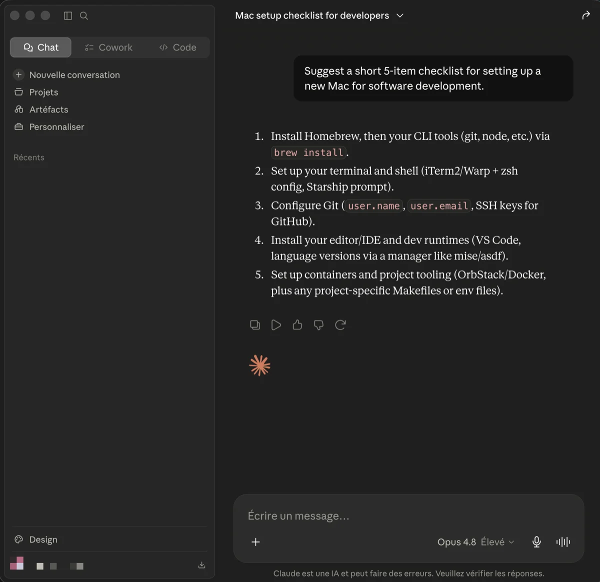

# Claude

[Claude](https://claude.ai/) is an AI assistant made by Anthropic. It is used for
reasoning, design decisions, code review, writing, and research tasks.

Three entry points are available in this setup:

| Entry point | Use |
| --- | --- |
| Desktop app | Conversations, file uploads, Projects |
| Claude Code CLI | Agentic coding directly in the terminal |
| Web (claude.ai) | Fallback when the desktop app is not available |

The desktop app is installed through Homebrew and declared in the project
`Brewfile`. Claude Code is installed separately with its native installer.



## Installation

### Desktop app

It is part of the curated Homebrew environment; see [`Homebrew setup`](../homebrew/homebrew.md) to install everything at once.

Install the Claude desktop app directly:

```bash
brew install --cask claude
```

Sign in with your Anthropic account after launch.

### Claude Code CLI

Claude Code has a native installation independent of Node.js. Follow the
[official setup guide](https://code.claude.com/docs/en/setup):

```bash
curl -fsSL https://claude.ai/install.sh | bash
```

Native installations manage their own updates. The `stable` and `latest`
channels can expose different versions, so compare the configured channel
before treating a version difference as a missed update. Keep existing
Homebrew or npm installations on their own channel instead of adding a second
copy. Check the resolved launcher with `type -a claude`.

Verify the installation:

```bash
claude --version
```

Claude Code authenticates through your Anthropic account. Run `claude` in any
project directory to start a session.

## Claude Projects

The desktop app supports Projects — persistent workspaces with a shared context
window and custom instructions. Use a Project for each long-running initiative:

- One project per active client or product.
- Add relevant documentation, architecture notes, and constraints as project
  files.
- Set a system prompt describing the project stack and conventions.

## Per-project configuration (Claude Code)

Claude Code reads `.claude/` from the project root. Version the project
instructions file:

```text
my-project/
  .claude/
    CLAUDE.md   # project-specific instructions for Claude Code
```

`CLAUDE.md` describes the stack, conventions, forbidden commands, and any
project-specific context Claude Code should always have.

## Security

- Never share API keys, tokens, or passwords in a conversation.
- Treat Claude as an external service: do not paste secrets, private keys, or
  confidential client data.
- Claude Code operates with the permissions of the current user. Review proposed
  file changes before approving them.

## Rollback

Remove the Claude desktop app with Homebrew:

```bash
brew uninstall --cask claude
```

Then remove its entry from `profiles/full/Brewfile`.

For Claude Code, follow the [uninstall instructions for your installation
method](https://code.claude.com/docs/en/setup#uninstall-claude-code). An npm
uninstall does not remove the native launcher. Review configuration and
credential removal separately from removing the executable.

---

[← Docs index](../README.md) · [Project README](../../README.md)
