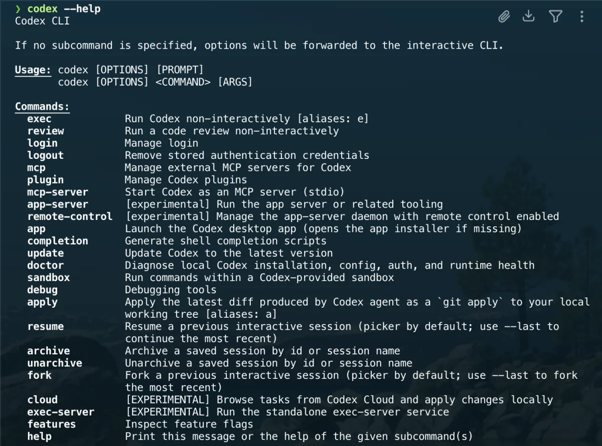

# Codex CLI

[Codex CLI](https://learn.chatgpt.com/docs/codex/cli) works with a local repository
from the terminal. Install it separately from this project's Homebrew profiles.
The CLI and the desktop app can have different versions and update channels.

## Installation and updates

The official macOS standalone installer does not require Node.js:

```bash
curl -fsSL https://chatgpt.com/codex/install.sh | sh
```

The same installer updates a standalone installation. If you originally installed
Codex through npm or Homebrew, keep using that installation channel instead.
Check which binary your shell resolves before adding another copy:

```bash
type -a codex
codex --version
```

See the [official installation guide](https://learn.chatgpt.com/docs/codex/cli)
for supported alternatives and current installer behavior.

## Authentication

Run `codex login` and sign in with ChatGPT for eligible subscription access.
API-key authentication is also available and uses API billing. An API key is
not required for ChatGPT sign-in.

If you intentionally use an API key, obtain it through your private environment
or secrets manager and pass it through stdin:

```bash
printenv OPENAI_API_KEY | codex login --with-api-key
```

Never commit credentials or the CLI authentication store. See
[authentication](https://learn.chatgpt.com/docs/auth) for sign-in and storage options.

## Usage and permissions

```bash
codex "explain the test suite in this repository"
codex --help
```

Permissions depend on the selected profile and environment. Codex can edit
workspace files without an individual approval for every write; choose a profile
that fits the task and review the resulting diff. See
[permissions](https://learn.chatgpt.com/docs/permissions).



Put project instructions in `AGENTS.md`. Keep runtime requirements, expected
checks, and deployment boundaries explicit. Model names and CLI flags evolve;
use the installed binary's help instead of copying an old example.

## Uninstall

Use the uninstall procedure for the channel that owns the binary shown by
`type -a codex`. An npm uninstall does not remove a standalone installation,
and removing a desktop app does not necessarily remove the separate CLI.
Preserve project files and review credential removal separately.

---

[← Docs index](../README.md) · [Project README](../../README.md)
