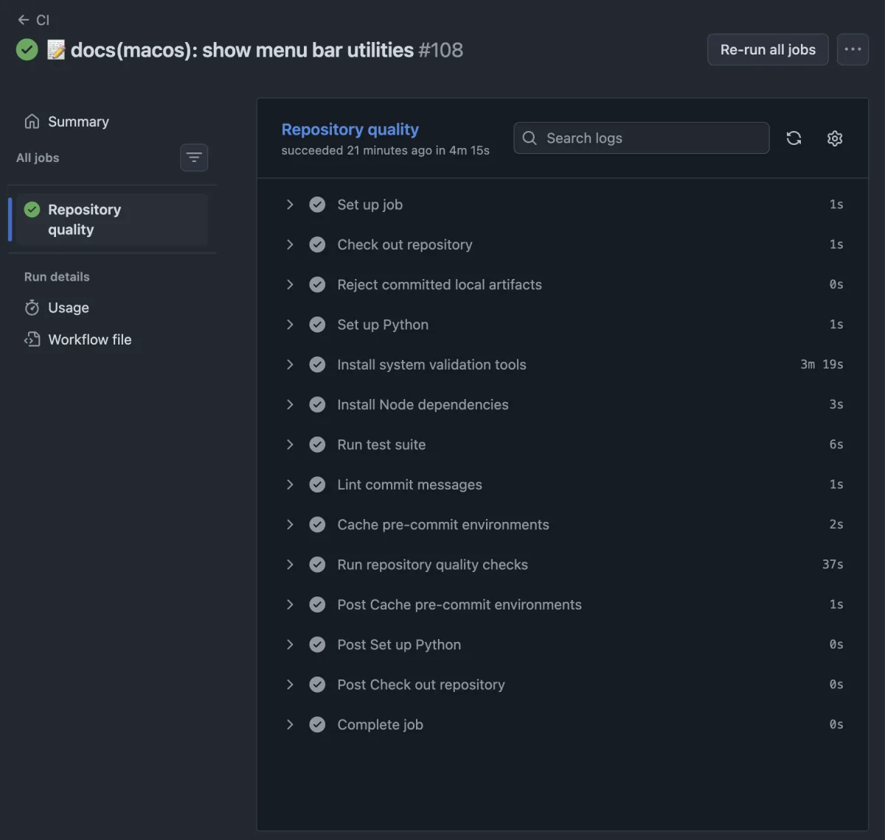

# Continuous integration

The repository uses GitHub Actions to validate its configuration, documentation, scripts, and security checks automatically.

The workflow is defined in:

```text
.github/workflows/ci.yml
```

## Triggers

The workflow runs automatically:

- on pushes to the `main` branch;
- on pull requests;
- when started manually through `workflow_dispatch`.

## Permissions

The workflow uses read-only repository permissions:

```yaml
permissions:
  contents: read
```

No write access is required for repository quality checks.

## Repository quality job

The workflow contains a `quality` job running on the latest Ubuntu GitHub-hosted runner.

Its purpose is to reproduce the repository-wide checks normally executed locally through `pre-commit`.



The workflow installs the tools required by hooks declared with:

```yaml
language: system
```

These tools include:

- `markdownlint-cli2`;
- `lychee`;
- `editorconfig-checker`;
- `actionlint`.

Hooks provided directly by remote pre-commit repositories, including Gitleaks, ShellCheck, and the standard pre-commit hooks, are installed automatically by `pre-commit`.

## Validation command

The complete repository is validated with:

```bash
pre-commit run --all-files --show-diff-on-failure
```

This keeps local and continuous integration checks aligned around the same configuration:

```text
.pre-commit-config.yaml
```

## Checks performed

The current workflow validates:

- trailing whitespace;
- missing final newlines;
- YAML syntax;
- accidentally added large files;
- unresolved merge conflict markers;
- private keys;
- hardcoded secrets with Gitleaks;
- Markdown formatting;
- documentation links;
- EditorConfig compliance;
- GitHub Actions workflow syntax;
- shell script linting with ShellCheck (`scripts/*.sh`, `install.sh`).

## Commit selection

The workflow calls `scripts/lint-commit-msg.sh --ci`. Selection is covered by
Bats tests and uses the event references passed through environment variables.

| Event | Commits checked |
| --- | --- |
| Pull request | `base..head`, including divergent branches |
| Push with accessible `before` | `before..after`, including force pushes |
| First push (`before` is all zeroes) | All history reachable from `after`, including roots |
| Manual dispatch | No commit delta; this check is explicitly skipped |
| Missing or invalid references | Failure, without narrowing the range |
| Valid empty range | Success with an explicit empty-range message |

Git failures propagate to the job. A successful commit check means Git actually
computed the requested history and every selected message passed validation.

## Tool versions and maintenance

Both workflows read the exact Node.js version from `.node-version`. The Ubuntu
workflow pins pre-commit and markdownlint-cli2, and downloads fixed releases of
Actionlint, Lychee and EditorConfig checker. Each archive is checked against a
SHA-256 digest recorded in the workflow before extraction.

To update a binary, change its release URL and digest together. Obtain the digest
from the upstream release asset metadata and verify the downloaded archive.
Run the corresponding checker locally, then validate the workflow with Actionlint.

Dependabot proposes monthly updates for GitHub Actions and npm dependencies.
Remote hook revisions are maintained with `pre-commit autoupdate`; review the
result and run all hooks before accepting it. There is no automatic merge.

These pins control tool selection. Hosted runners, APT packages, Python/npm
transitive dependencies and Homebrew packages still evolve. The macOS job uses
current Homebrew packages intentionally to detect integration drift.

## macOS workflow

An additional macOS workflow validates platform-specific behavior:

- `.github/workflows/ci-macos.yml` runs the test suite, checks the setup CLI
  contract (`--dry-run`), installs the full Homebrew profile, applies setup
  once, and runs the verification and hardening checks (`scripts/verify.sh`).

The macOS runner already provides Homebrew. Cold installation and environment
activation are tested with disposable command doubles for Intel and Apple
Silicon; this does not replace a real fresh-Mac installation test.

## Pre-commit cache

GitHub Actions caches pre-commit environments under:

```text
~/.cache/pre-commit
```

The cache key includes the operating system and a hash of:

```text
.pre-commit-config.yaml
```

Changing the pre-commit configuration therefore creates a new cache automatically.

## Validate locally

Validate the workflow structure without executing it:

```bash
actionlint .github/workflows/ci.yml
```

Run the same repository checks locally:

```bash
pre-commit run --all-files
```

Run the quality job locally with Act:

```bash
act pull_request \
  --job quality \
  --container-architecture linux/amd64 \
  -P ubuntu-latest=catthehacker/ubuntu:act-latest \
  --pull=false
```

Act provides useful local feedback but does not reproduce GitHub-hosted runners perfectly.

A successful run on GitHub Actions remains the final validation.

## Inspect GitHub Actions runs

List recent workflow executions:

```bash
gh run list \
  --workflow CI \
  --limit 5
```

Inspect the latest failed workflow logs:

```bash
gh run view --log-failed
```

## Related documentation

- [Act local GitHub Actions execution](act.md)
- [Actionlint GitHub Actions workflow validation](actionlint.md)
- [Pre-commit and Gitleaks](../quality/pre-commit.md)

---

[← Docs index](../README.md) · [Project README](../../README.md)
